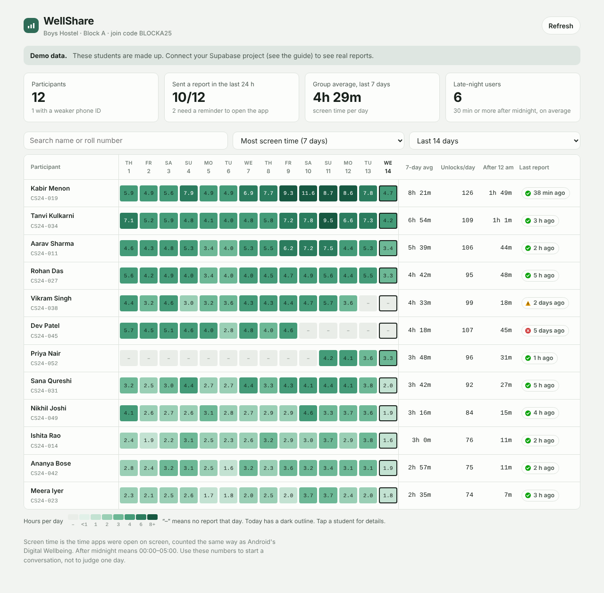

# WellShare

**Share your phone's Digital Wellbeing report with your mentor.**
An open-source Android app plus a mentor dashboard, built for hostels where everyone is on the same Wi-Fi.

- Each student's phone sends its daily screen time, unlocks, after-midnight use and top apps.
- The mentor sees one dashboard for the whole group, and a detailed report for every participant.
- **One phone = one participant.** A phone can't register a second student, not even from a second user profile, a work profile or after reinstalling. A roll number can't be registered on a second phone.
- Free to run: GitHub (code, app downloads, dashboard hosting) + Supabase free tier (database).



---

## How it works

```
 Student's phone                    Supabase (database)                  Mentor
 ┌──────────────────┐   every ~4 h  ┌─────────────────────────┐  sign in  ┌──────────────────────┐
 │ WellShare app    │ ────────────▶ │ register_device()       │ ◀──────── │ Dashboard on         │
 │ reads Android's  │   7 days of   │ upload_usage()          │           │ GitHub Pages         │
 │ usage log (same  │   totals      │ Row Level Security:     │           │ - group register     │
 │ data as Digital  │               │ mentors read only their │           │ - per-student report │
 │ Wellbeing)       │               │ own group               │           │ - reset phone link   │
 └──────────────────┘               └─────────────────────────┘           └──────────────────────┘
```

**Why same Wi-Fi doesn't matter:** students are told apart by their phone, not by network address. The app makes a one-way hash of the phone's hardware DRM ID. That ID is identical on every user profile of the phone and survives reinstalls, so the server can refuse a second registration from the same handset.

**Rules enforced by the database (they can't be bypassed by changing the app):**

| Rule | How |
|---|---|
| One phone → one participant | `device_hash` is unique |
| One participant → one phone | `(group, roll_no)` is unique |
| Reinstall on the same phone | Re-links the same student; history is kept |
| Upload token copied to another phone | Rejected (`DEVICE_MISMATCH`) |
| Phones can't read anyone's data | Phones may only call two functions |
| Mentor sees only their group | Row Level Security policies |
| Random people signing up | They see nothing (they aren't in the `mentors` table) |

---

## What you need

- A **GitHub** account (free) — <https://github.com/signup>
- A **Supabase** account (free) — <https://supabase.com>
- About 20–30 minutes. A laptop makes Step 3 easiest; everything else works from a phone browser.
- Students need **Android 8 or newer**. (iPhones don't let apps export Screen Time data, so iOS isn't possible.)

---

## Setup

### Step 1 — Create the database (Supabase)

1. Sign in to Supabase → **New project**. Pick a name (e.g. `wellshare`), set a database password (save it), and choose the region closest to you (e.g. **Mumbai**).
2. Wait until the project is ready, then open **SQL Editor** → **New query**.
3. Open [`supabase/schema.sql`](supabase/schema.sql) from this repo, copy **all** of it, paste it into the editor and press **Run**. You should see "Success. No rows returned".
4. Recommended: **Authentication → Sign In / Providers** → turn **off** "Allow new users to sign up". Only the admin then creates mentor logins.

### Step 2 — Create the mentor login and the group

1. **Authentication → Users → Add user → Create new user.** Enter the mentor's email and a password, tick **Auto Confirm User**, and create it.
2. Back in **SQL Editor**, run this (change the three values):

   ```sql
   select public.setup_group('Boys Hostel Block A', 'BLOCKA25', 'mentor@college.edu');
   ```

   - `'Boys Hostel Block A'` is the group name the mentor sees.
   - `'BLOCKA25'` is the **join code** students type into the app.
   - Run it again with another code for more groups, or with another email to add a second mentor to the same group.
3. Copy two values for later (Supabase dashboard → **Project Settings**):
   - **Project URL** — looks like `https://abcdefghijkl.supabase.co` (under **Data API**, or on the project home page).
   - **Publishable key** — starts with `sb_publishable_` (under **API Keys**). Older projects can use the legacy **anon** key instead.

   Both are safe to put in the app: the database rules above are what protect the data. **Never** use the `secret` / `service_role` key.

### Step 3 — Put the code on GitHub

Create a new **public** repository on GitHub named `wellshare` (no README, no license — this project has them).

**Option A — with Git (recommended):** unzip the project, open a terminal in the `wellshare` folder and run:

```bash
git init -b main
git add .
git commit -m "WellShare first version"
git remote add origin https://github.com/YOUR-USERNAME/wellshare.git
git push -u origin main
```

**Option B — website only:** on the new repo page click **uploading an existing file**, drag in *everything inside* the unzipped `wellshare` folder, and commit.
Make sure the hidden `.github` folder came along: the **Actions** tab should list "Android app", "Mentor dashboard" and "Tests". If it doesn't, use **Add file → Create new file**, type the name `.github/workflows/android-release.yml`, paste that file's contents, and repeat for the other two workflow files.

### Step 4 — Add your secrets

Repo → **Settings → Secrets and variables → Actions → New repository secret.** Add:

| Name | Value |
|---|---|
| `SUPABASE_URL` | your Project URL |
| `SUPABASE_KEY` | your publishable (or anon) key |

### Step 5 — Publish the mentor dashboard

1. Repo → **Settings → Pages** → under *Build and deployment*, set **Source** to **GitHub Actions**.
2. **Actions** tab → **Mentor dashboard** → **Run workflow**.
3. After about a minute it's live at **`https://YOUR-USERNAME.github.io/wellshare/`**. The mentor signs in with the login from Step 2.

Want to look around first? Add `#demo` to the address to see made-up demo data.

### Step 6 — Build and publish the app

1. Repo → **Releases** (right-hand side) → **Draft a new release**.
2. **Choose a tag** → type `v1.0.0` → **Create new tag**. Title: `WellShare 1.0.0`. Click **Publish release**.
3. The **Android app** workflow builds the APK (about 5 minutes) and attaches `WellShare-1.0.0.apk` to that release.

Share this link with students: **`https://github.com/YOUR-USERNAME/wellshare/releases/latest`**

> Before you have many students, set up a [permanent signing key](#permanent-signing-key-recommended). Without one, every new version needs an uninstall first.

### Step 7 — Students install and join

On each student's phone:

1. Open the releases link → tap **WellShare-x.y.z.apk** → download → **Install**. If asked, allow the browser to *install unknown apps*. If Play Protect warns about an unknown app, tap **More details → Install anyway**.
2. Open WellShare and read what's shared → tick the box → **Continue**.
3. **Open usage access settings** → tap **WellShare** → turn on **Permit usage access**.
   - **Switch greyed out / "Restricted setting"?** (Android 13+ does this for downloaded apps.) Go to **Settings → Apps → WellShare → ⋮ → Allow restricted settings**, then try again. The app shows these steps too.
4. Enter the **group code**, **full name** and **roll number** → **Register this phone**.
5. On Xiaomi, Redmi, Poco, Realme, Oppo, Vivo or OnePlus phones: **Settings → Apps → WellShare → Battery → No restrictions / Unrestricted**, so updates keep arriving in the background.

That's it. The phone sends the last 7 days right away and then about every 4 hours when online.

---

## Using the dashboard (mentors)

- **Register view:** one row per student, one column per day. Darker cells mean more hours. "–" means no report that day.
- **Last report** chip: ✓ green = within 24 h, ⚠ yellow = 1–3 days, ✕ red = longer or never. Remind those students to open the app.
- **Late-night users:** students averaging 30+ minutes between 00:00 and 05:00.
- Tap a student for their 30-day chart, top apps, a day-by-day table, and **Reset phone link** (use it when they change phones; it deletes their reports and frees the phone and roll number).
- **Download CSV** exports the daily numbers for everyone.

Use the numbers to start a conversation. One heavy day is normal; patterns over weeks matter more.

---

## Permanent signing key (recommended)

Android only installs an update over an old version if both were signed with the same key. Make one once:

1. On any computer with Java (or free in the browser: on your repo click **Code → Codespaces → Create codespace**), run:

   ```bash
   keytool -genkeypair -v -keystore wellshare.jks -alias wellshare -keyalg RSA -keysize 2048 -validity 10000
   base64 -w0 wellshare.jks > wellshare.jks.txt
   ```

   Choose a strong password when asked. (On a Mac, use `base64 -i wellshare.jks -o wellshare.jks.txt`.)
2. Add four more repository secrets:

   | Name | Value |
   |---|---|
   | `ANDROID_KEYSTORE_BASE64` | the whole content of `wellshare.jks.txt` |
   | `ANDROID_KEYSTORE_PASSWORD` | the password you chose |
   | `ANDROID_KEY_ALIAS` | `wellshare` |
   | `ANDROID_KEY_PASSWORD` | the same password |

3. Keep `wellshare.jks` and its password somewhere safe and private. **Never commit it** (`.gitignore` already blocks it). Delete it from the codespace afterwards.

## Updating the app

Change the code, push, then publish a new release with a higher tag (`v1.0.1`, `v1.1.0`, …). Students download the new APK and install it over the old one. Their registration and history are kept.

---

## Troubleshooting

| Problem | Fix |
|---|---|
| Android app workflow fails at "Check server settings" | Add the `SUPABASE_URL` and `SUPABASE_KEY` secrets (Step 4), then re-run. |
| Dashboard shows "Demo data" | The secrets were missing when it was deployed. Add them and re-run **Mentor dashboard**. |
| "That group code doesn't exist" | Check the code from Step 2 (it isn't case-sensitive). |
| "This phone is already registered to another student" | Working as intended. If it's a mistake, the mentor uses **Reset phone link** on the wrong entry. |
| "This roll number is already linked to a different phone" | Student changed phones: mentor resets the old link, student registers again. |
| "You aren't a mentor of any group yet" | Run `setup_group(...)` with that mentor's exact email. |
| Student shows red "Never sent" / old date | Open the app and tap **Send to mentor now**; check usage access and battery settings; log in to the hostel Wi-Fi portal if it has one. |
| Can't install update ("App not installed") | The new APK was signed with a different key. Uninstall, reinstall, register again with the same roll number (history is kept). Then set up a permanent key. |
| Supabase project paused | Free projects pause after a period with no activity. Daily phone uploads normally keep it awake; you can resume it from the Supabase dashboard. |

## Honest limits

- **Android only.** Apple doesn't allow apps to read or export Screen Time.
- The app reads the usage of the **profile it's installed in**. A second profile on the same phone can't register as another student, but time spent *only* in another profile isn't counted.
- Numbers can differ a little from Digital Wellbeing, because each counts screen-on time slightly differently.
- Android keeps roughly 1–2 weeks of usage history, so a phone that is offline for longer loses the oldest days.
- A student can always uninstall the app or turn usage access off. The dashboard shows that as an old "Last report".
- Phones on Android 8 don't report unlock counts (shown as "–").
- A few phones without a Widevine DRM module fall back to Android's per-profile ID. The dashboard marks these as **Weaker phone ID**.

Tell participants exactly what is collected before they join. [`PRIVACY.md`](PRIVACY.md) is a ready-made notice you can edit and share.

---

## Project layout

```
android/               Android app (Kotlin, no third-party libraries)
  app/src/main/java/org/wellshare/app/
    MainActivity.kt    Consent → usage access → register → "Your digital wellbeing" screen
    UsageCollector.kt  Reads Android's usage event log
    UsageMath.kt       Turns events into daily totals (pure Kotlin, unit-tested)
    DeviceId.kt        One stable, hashed ID per physical phone
    Api.kt             Calls register_device / upload_usage
    Sync.kt            Background upload every ~4 h (JobScheduler)
  app/src/test/...     Screen-time math tests
dashboard/index.html   Mentor dashboard (single file, works on GitHub Pages)
supabase/schema.sql    Tables, security rules and functions
supabase/test/         Database rule tests (in-memory Postgres, no account needed)
.github/workflows/     Build APK on release · deploy dashboard · run tests
```

## Run the tests yourself

```bash
# Database rules (needs Node.js 18+)
cd supabase/test && npm install && npm test

# Screen-time math (needs a JDK and kotlinc)
cd android
kotlinc app/src/main/java/org/wellshare/app/UsageMath.kt app/src/test/java/org/wellshare/app/UsageMathTest.kt -include-runtime -d t.jar
java -cp t.jar org.wellshare.app.UsageMathTestKt
```

Both also run automatically on every push (the **Tests** workflow).

## Building on your own computer

Open the `android` folder in Android Studio, copy `local.properties.example` to `local.properties`, fill in your URL and key, then **Build → Build APK(s)**.

## Contributing

Issues and pull requests are welcome. Please keep the app free of trackers and third-party SDKs, and keep the data rules in `schema.sql` (with a test for any new rule).

## License

[MIT](LICENSE)
